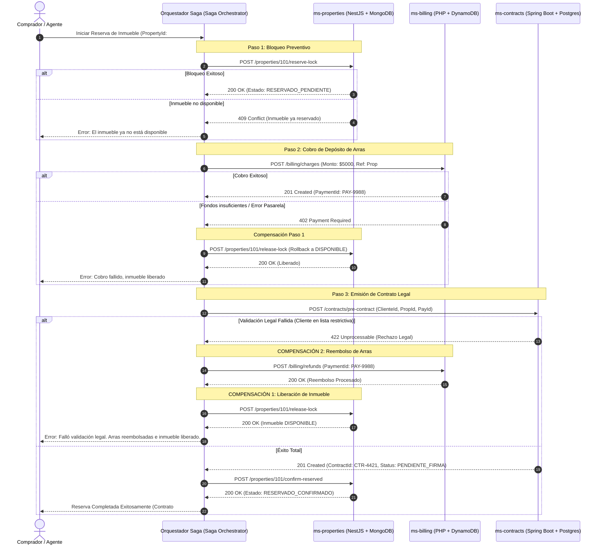
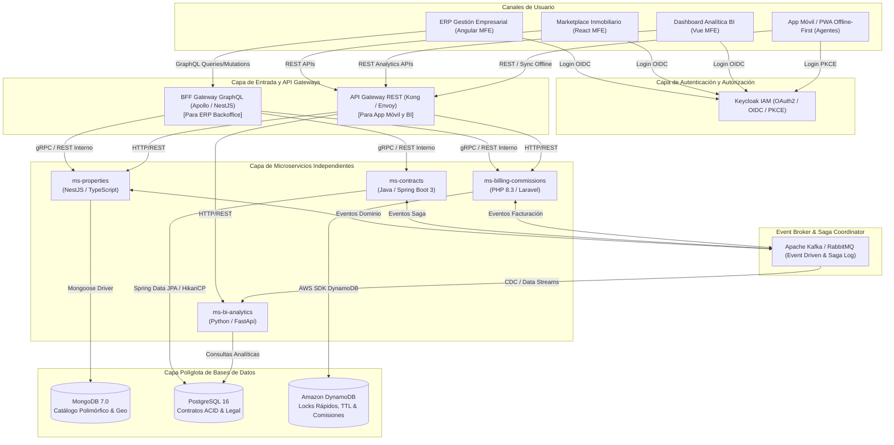

# ARQUITECTURA DE SOFTWARE: PLATAFORMA PROPTECH (INMOBILIARIA INTEGRAL)

**Documento de Arquitectura y Especificación Técnica**  
**Versión:** 1.0.0  
**Perfil:** Arquitecto de Software Senior  

---

## 1. ALCANCE, ACTORES, MÓDULOS Y ECOSISTEMA DE APLICACIONES

### 1.1. Visión y Alcance del Proyecto
La plataforma inmobiliaria (PropTech) centraliza la gestión del ciclo de vida inmobiliario: captación, catalogación de inmuebles residenciales y comerciales, agenda de visitas, reservas de compra/alquiler con arras, generación y firma de contratos legales, liquidación de comisiones a corredores y análisis predictivo de valorización y demanda por zonas geográficas.

### 1.2. Ecosistema de Aplicaciones
1. **Sistema de Gestión Empresarial (ERP / Backoffice Web):**
   - Aplicación de escritorio web para administradores, abogados inmobiliarios y brokers seniors.
   - Consume una capa unificada mediante **GraphQL** para consultar modelos de datos relacionales y documentales complejos sin incurrir en over-fetching.
2. **App Móvil / PWA de Campo (Agentes y Clientes):**
   - Diseñada como PWA híbrida/móvil para agentes inmobiliarios en campo (visitas a propiedades, captaciones en obra) y clientes (búsqueda, reserva y firma digital).
   - Cuenta con soporte **Offline-First** para inspecciones en sótanos, zonas rurales o edificios sin cobertura celular.
3. **App de Inteligencia de Negocios y Dashboards (BI):**
   - Plataforma analítica para directores de inversión y gerentes comerciales.
   - Proporciona métricas de rotación de cartera, tasa de conversión de visitas, absorción de m² y rentabilidad por agente/zona.

### 1.3. Actores del Sistema
- **Agente Inmobiliario (Broker):** Gestiona propiedades, agenda visitas presenciales/virtuales, registra actas de visita en campo y solicita reservas.
- **Cliente (Comprador / Inquilino / Inversionista):** Explora el catálogo, programa visitas, entrega ofertas y firma digitalmente contratos de reserva.
- **Propietario / Desarrollador Inmobiliario:** Consigna inmuebles, revisa el estado de ocupación, aprueba ofertas y recibe liquidaciones de rentas.
- **Oficial Legal / Notarial:** Redacta, valida cláusulas, gestiona anexos y aprueba contratos de arras y escrituración.
- **Administrador Financiero:** Gestiona cobros, dispersión de comisiones, facturación electrónica y pagos a propietarios.
- **Analista de Negocio / Directorio:** Monitorea KPIs de absorción, precios promedio por m² y rentabilidad.

### 1.4. Módulos Funcionales
- **Módulo 1: Catálogo y Ficha Técnica de Inmuebles:** Registro polimórfico de propiedades (terrenos, oficinas, departamentos), fotos en CDN, recorridos 3D y coordenadas GIS.
- **Módulo 2: CRM y Gestión de Visitas:** Registro de prospectos, agendamiento de visitas, geolocalización de check-in de agentes.
- **Módulo 3: Negociación, Reservas y Arras:** Bloqueo temporal de unidades con depósito de garantía (arras).
- **Módulo 4: Contratos y Asuntos Legales:** Generación de contratos basados en plantillas, validación de antecedentes, trazabilidad de firmas electrónicas.
- **Módulo 5: Facturación, Pagos y Comisiones:** Procesamiento de pagos, facturas fiscales, retenciones impositivas y asignación de comisiones porcentuales a corredores.
- **Módulo 6: Inteligencia de Negocios (BI) y Valoración:** Pipeline de ingesta analítica, mapas de calor de precios y demanda inmobiliaria.

---

## 2. ESTRUCTURA DE REPOSITORIOS Y DIRECTORIOS

Cada microservicio y microfrontend residirá en su **propia carpeta raíz independiente** (enfoque Multi-Repository o Monorepo con límites estrictos), garantizando desacoplamiento de ciclo de vida, CI/CD y despliegue:

```text
parcial2/
├── ms-properties-nestjs/           # Microservicio de Catálogo y Multimedia (NestJS + MongoDB)
├── ms-contracts-spring/            # Microservicio de Contratos y Legal (Spring Boot + PostgreSQL)
├── ms-billing-php/                 # Microservicio de Facturación y Comisiones (PHP + DynamoDB/Postgres)
├── ms-reservations-dynamo/         # Microservicio de Reservas Rápidas y Bloqueos (NestJS/Go + DynamoDB)
├── mfe-shell/                      # Microfrontend Contenedor (Host / Module Federation)
├── mfe-properties-react/           # Microfrontend Catálogo y Ficha de Propiedades (React)
├── mfe-contracts-angular/          # Microfrontend Gestión Contractual y ERP (Angular)
├── mfe-bi-vue/                     # Microfrontend Dashboards Analíticos (Vue 3)
├── bff-graphql-gateway/            # API Gateway BFF con GraphQL para el ERP
├── docker-compose.yml              # Orquestación local de BDs (Postgres, Mongo, DynamoDB-Local, Keycloak)
└── ARCHITECTURE.md                 # Esta documentación
```

---

## 3. DISEÑO DE MICROSERVICIOS Y MODELO DE DATOS

### 3.1. Microservicio 1: Catálogo de Inmuebles (`ms-properties`)
- **Tecnología:** NestJS 10 (TypeScript, Node.js runtime).
- **Base de Datos:** **MongoDB 7.0**.
  - *Justificación Técnica:* Los inmuebles son **documentos altamente polimórficos**. Un departamento requiere atributos como dormitorios, baños, piso, costo de expensas y balcón; mientras que un terreno requiere zonificación, frente, fondo y topografía; y un edificio corporativo demanda carga eléctrica y cajones de estacionamiento. MongoDB permite esquemas dinámicos con `Document Validation`, indexación geoespacial nativa (`2dsphere`) para búsquedas por radio de proximidad ("propiedades a menos de 2 km de mi ubicación") y almacenamiento de metadatos multimedia (URLs de S3, galerías 360°).
- **Responsabilidad:** Alta, edición, filtrado avanzado, georreferenciación y gestión de estados de disponibilidad de inmuebles (`DISPONIBLE`, `EN_RESERVA`, `BLOQUEADO`, `VENDIDO`, `ALQUILADO`).
- **Endpoints REST Principales:**
  - `POST /api/v1/properties`: Creación de ficha técnica de inmueble.
  - `GET /api/v1/properties/search?lat=-16.50&lng=-68.15&radius=5000`: Búsqueda geoespacial.
  - `PATCH /api/v1/properties/{id}/status`: Actualización atómica de estado de disponibilidad.
  - `POST /api/v1/properties/{id}/media`: Subida de anexos fotográficos y planos.

### 3.2. Microservicio 2: Contratos y Gestión Legal (`ms-contracts`)
- **Tecnología:** Java 21 con Spring Boot 3.3.
- **Base de Datos:** **PostgreSQL 16**.
  - *Justificación Técnica:* La gestión de contratos de promesa de compraventa, arrendamiento y minutas notariales requiere cumplimiento estricto de propiedades **ACID (Atomicidad, Consistencia, Aislamiento y Durabilidad)**. Se requiere integridad referencial rígida entre compradores, vendedores, garantes, cláusulas resolutorias, penalidades y versiones inmutables del contrato. Postgres ofrece transacciones con nivel de aislamiento serializable, soporte para llaves foráneas y auditoría estricta de auditoría forense (`temporal tables`).
- **Responsabilidad:** Generación de contratos, control de versiones de plantillas legales, orquestación de firmas electrónicas, validación de poderes legales y ciclo de vida del contrato (`BORRADOR`, `EN_REVISION`, `FIRMADO`, `CANCELADO`).
- **Endpoints REST Principales:**
  - `POST /api/v1/contracts`: Creación de borrador de contrato asociado a una propiedad y partes.
  - `GET /api/v1/contracts/{id}`: Obtención del contrato con su árbol de cláusulas y anexos.
  - `POST /api/v1/contracts/{id}/signatures`: Registro de evento de firma electrónica calificada.
  - `POST /api/v1/contracts/{id}/cancel`: Anulación de contrato y activación de cláusula resolutoria.

### 3.3. Microservicio 3: Facturación y Comisiones (`ms-billing-commissions`)
- **Tecnología:** PHP 8.3 (Laravel 11 / Symfony Microframework).
- **Base de Datos:** **Amazon DynamoDB** (complementado con PostgreSQL para libros contables históricos si se requiere).
  - *Justificación Técnica de DynamoDB:* 
    1. **Bloqueos Temporales y Reservas con TTL:** Las reservas de inmuebles expiran automáticamente en 48 o 72 horas si no se depositan las arras. DynamoDB proporciona la característica **TTL (Time to Live)** a nivel de registro sin sobrecargar la base de datos con cron jobs de limpieza.
    2. **Escritura a Escala y Baja Latencia:** En lanzamientos de proyectos inmobiliarios en preventa ("open houses" o ferias inmobiliarias), cientos de brokers compiten por bloquear lotes o departamentos al mismo segundo. DynamoDB soporta miles de transacciones concurrentes con latencias de un solo dígito de milisegundo mediante escrituras atómicas condicionales (`attribute_not_exists` / `ConditionExpression`).
    3. **Particionamiento natural por `PropertyId` y `AgentId`**: Búsquedas instantáneas de comisiones acumuladas del mes y estados de balance.
- **Responsabilidad:** Procesamiento de cobro de arras/garantías, registro de facturas fiscales, cálculo de comisiones escalonadas a corredores según cumplimiento de metas de venta y liquidación a propietarios.
- **Endpoints REST Principales:**
  - `POST /api/v1/billing/charges`: Procesamiento de cobro de reserva/arras.
  - `POST /api/v1/billing/refunds`: Reembolso inmediato de arras por desistimiento dentro del plazo.
  - `POST /api/v1/commissions/calculate`: Cálculo y liquidación de comisión para el broker.
  - `GET /api/v1/commissions/agent/{agentId}`: Consulta de comisiones pendientes y pagadas.

---

## 4. PATRÓN SAGA: TRANSACCIÓN DISTRIBUIDA CON COMPENSACIONES

### 4.1. Escenario Inmobiliario: "Reserva de Inmueble con Depósito de Arras y Generación de Pre-Contrato"
Cuando un comprador desea reservar un departamento en preventa:
1. Se debe **bloquear el inmueble** para evitar que otro agente lo ofrezca (`ms-properties`).
2. Se debe **procesar el cobro de la seña/arras** bancarias ($5,000 USD) (`ms-billing-commissions`).
3. Se debe **emitir el pre-contrato legal de reserva** con validez jurídica (`ms-contracts`).

Si el cobro falla, o si la validación legal del comprador en listas restrictivas/notariales falla en `ms-contracts`, **la transacción debe compensarse** (devolver el dinero si se cobró y desbloquear inmediatamente el inmueble a `DISPONIBLE`).

### 4.2. Pasos y Transacciones Compensatorias

| Paso | Microservicio | Acción Transaccional (Forward) | Acción Compensatoria (Rollback) |
|---|---|---|---|
| **Paso 1** | `ms-properties` | Cambiar estado del inmueble a `RESERVADO_PENDIENTE`. | Revertir estado del inmueble a `DISPONIBLE`. |
| **Paso 2** | `ms-billing` | Bloquear fondos / Procesar cobro de arras en pasarela. | Ejecutar reembolso bancario (Refund) de las arras. |
| **Paso 3** | `ms-contracts` | Generar borrador de contrato y validar personería jurídica. | Anular borrador y marcar contrato como `RECHAZADO`. |

### 4.3. Diagrama de Secuencia del Patrón Saga (Orquestado con Compensación)



---

## 5. DIAGRAMA DE COMPONENTES GENERAL DE LA ARQUITECTURA



---

## 6. FRONTEND CON MICROFRONTENDS (SHELL Y 3 MFEs)

### 6.1. Estrategia de Microfrontends: Webpack 5 Module Federation
Para permitir que múltiples equipos desarrollen de forma autónoma con diferentes tecnologías, se utiliza una arquitectura de **Microfrontends basada en Webpack 5 Module Federation**:

1. **`mfe-shell` (Host / Shell Container):**
   - Construido con TypeScript y Vanilla/React liviano.
   - Responsabilidades:
     - Gestiona el **Layout global** (barra de navegación superior, sidebar colapsable, pie de página).
     - Orquesta el **Single Sign-On (SSO)** con Keycloak JS Adapter.
     - Contiene el **Router principal** que descarga los microfrontends bajo demanda (*lazy loading* con dynamic imports).
     - Provee el **Event Bus compartido** (CustomEvent / Redux micro-state) para comunicación desacoplada.
2. **`mfe-contracts-angular` (Angular 17+):**
   - Microfrontend del **Sistema de Gestión Empresarial (ERP)** para redacción legal de contratos, seguimiento notarial y aprobación de cláusulas.
   - *Por qué Angular:* Su estructura fuertemente tipada con inyección de dependencias, formularios reactivos complejos (`FormGroup` dinámicos) y soporte empresarial es idónea para procesos corporativos y auditoría legal.
3. **`mfe-properties-react` (React 18 + Vite/Webpack):**
   - Microfrontend del **Catálogo y Ficha de Inmuebles**.
   - *Por qué React:* Ecosistema rico para renderizado de mapas interactivos (Mapbox GL / Leaflet), galerías de imágenes de alta velocidad y filtros en tiempo real mediante componentes funcionales y Virtual DOM.
4. **`mfe-bi-vue` (Vue 3 + Chart.js / ECharts):**
   - Microfrontend de **Inteligencia de Negocios y Dashboards**.
   - *Por qué Vue 3:* Curva de reactividad óptima (`Composition API`) para gráficos en tiempo real, widgets visuales de métricas financieras y dashboards livianos de alta performance.

### 6.2. Configuración de Module Federation (`webpack.config.js`)

**En el Shell (`mfe-shell`):**
```javascript
// mfe-shell/webpack.config.js
const { ModuleFederationPlugin } = require('webpack').container;

module.exports = {
  plugins: [
    new ModuleFederationPlugin({
      name: 'shell',
      remotes: {
        mfe_properties: 'mfe_properties@http://localhost:3001/remoteEntry.js',
        mfe_contracts: 'mfe_contracts@http://localhost:3002/remoteEntry.js',
        mfe_bi: 'mfe_bi@http://localhost:3003/remoteEntry.js',
      },
      shared: {
        rxjs: { singleton: true, strictVersion: true },
        'keycloak-js': { singleton: true },
      },
    }),
  ],
};
```

**En el Microfrontend de Propiedades (`mfe-properties-react`):**
```javascript
// mfe-properties-react/webpack.config.js
module.exports = {
  plugins: [
    new ModuleFederationPlugin({
      name: 'mfe_properties',
      filename: 'remoteEntry.js',
      exposes: {
        './PropertyExplorer': './src/components/PropertyExplorer',
        './PropertyDetail': './src/components/PropertyDetail',
      },
      shared: {
        react: { singleton: true, requiredVersion: '^18.2.0' },
        'react-dom': { singleton: true, requiredVersion: '^18.2.0' },
      },
    }),
  ],
};
```

---

## 7. CAPA DE APIs: GRAPHQL OBLIGATORIO Y REST

### 7.1. Beneficios Clave de GraphQL frente a REST en el Sistema de Gestión Empresarial (ERP)
1. **Eliminación del Over-fetching:** En inmobiliarias, una propiedad tiene más de 60 atributos (metraje, amenidades, geolocalización, comisiones, impuestos, historial notarial). Si la tabla del ERP solo requiere mostrar `id`, `código`, `precio` y `estado`, REST enviaría cientos de kilobytes innecesarios por cada una de las 10,000 propiedades listadas. GraphQL permite pedir exactamente los 4 campos requeridos.
2. **Eliminación del Under-fetching y Múltiples Roundtrips (N+1):** Para desplegar la vista de un contrato en el ERP, REST requeriría:
   - `GET /contracts/44` (datos del contrato)
   - `GET /properties/101` (datos del inmueble)
   - `GET /clients/90` (datos del comprador)
   - `GET /agents/12` (datos del agente comisionista)
   Con GraphQL, se resuelve en **un único request HTTP** mediante anidación de relaciones y optimización con `DataLoader`.
3. **Tipado Estricto (Schema Driven Development):** El contrato SDL (`schema.graphql`) actúa como fuente única de verdad entre backend y frontend, facilitando autocompletado y validación en tiempo de compilación.

### 7.2. Esquema GraphQL del Sistema de Gestión (`schema.graphql`)

```graphql
"""
Estado de disponibilidad de la propiedad
"""
enum PropertyStatus {
  DISPONIBLE
  RESERVADO_PENDIENTE
  RESERVADO_CONFIRMADO
  VENDIDO
  ALQUILADO
}

enum ContractType {
  PROMESA_COMPRAVENTA
  ARRENDAMIENTO
  EXCLUSIVIDAD_VENTA
}

enum ContractStatus {
  BORRADOR
  PENDIENTE_FIRMA
  FIRMADO
  CANCELADO
}

type Property {
  id: ID!
  code: String!
  title: String!
  description: String
  price: Float!
  currency: String!
  status: PropertyStatus!
  areaSquareMeters: Float!
  rooms: Int
  bathrooms: Int
  address: String!
  city: String!
  latitude: Float!
  longitude: Float!
  photos: [String!]!
}

type Agent {
  id: ID!
  fullName: String!
  licenseNumber: String!
  email: String!
  phone: String!
}

type Client {
  id: ID!
  identificationNumber: String!
  fullName: String!
  email: String!
  phoneNumber: String!
}

type Contract {
  id: ID!
  contractNumber: String!
  contractType: ContractType!
  status: ContractStatus!
  property: Property!
  client: Client!
  agent: Agent!
  totalAmount: Float!
  downPayment: Float!
  signingDate: String
  expirationDate: String!
  legalClauses: [String!]!
}

input CreateReservationInput {
  propertyId: ID!
  clientId: ID!
  agentId: ID!
  depositAmount: Float!
  contractType: ContractType!
  validityDays: Int!
}

input UpdatePropertyStatusInput {
  propertyId: ID!
  newStatus: PropertyStatus!
}

type Query {
  # Obtener detalle de contrato con relaciones anidadas
  contract(id: ID!): Contract
  
  # Listado paginado de contratos para el ERP
  contracts(status: ContractStatus, limit: Int = 20, offset: Int = 0): [Contract!]!
  
  # Buscar propiedades con filtros
  properties(status: PropertyStatus, city: String, minPrice: Float, maxPrice: Float): [Property!]!
  
  # Detalle de propiedad
  property(id: ID!): Property
}

type Mutation {
  # Orquesta la reserva con el patrón Saga
  createReservation(input: CreateReservationInput!): Contract!
  
  # Cambio de estado de propiedad
  updatePropertyStatus(input: UpdatePropertyStatusInput!): Property!
  
  # Aprobación notarial de contrato
  approveContract(contractId: ID!, notaryRegistrationNumber: String!): Contract!
}
```

### 7.3. Ejemplo de Consulta y Mutación GraphQL

**Query para la ficha de revisión legal en el ERP:**
```graphql
query GetContractLegalReview($contractId: ID!) {
  contract(id: $contractId) {
    id
    contractNumber
    status
    totalAmount
    downPayment
    property {
      code
      title
      address
      areaSquareMeters
    }
    client {
      fullName
      identificationNumber
      email
    }
    agent {
      fullName
      licenseNumber
    }
    legalClauses
  }
}
```

**Mutation para iniciar reserva desde el ERP:**
```graphql
mutation IniciarReserva {
  createReservation(input: {
    propertyId: "6501a9b4f1"
    clientId: "CLI-909"
    agentId: "AGT-12"
    depositAmount: 5000.00
    contractType: PROMESA_COMPRAVENTA
    validityDays: 15
  }) {
    id
    contractNumber
    status
    downPayment
  }
}
```

---

## 8. INICIO DE SESIÓN ÚNICO (SSO) CON KEYCLOAK / OIDC

### 8.1. Arquitectura de Autenticación Centralizada
Se implementa **Keycloak** como Identity and Access Management (IAM) central bajo el estándar **OAuth 2.0 y OpenID Connect (OIDC)**:
- **Flujo de Autorización:** Authorization Code Flow con **PKCE (Proof Key for Code Exchange)** para aplicaciones Single Page (Microfrontends) y la aplicación Móvil PWA, eliminando secretos embebidos en el cliente.
- **Client Credentials Grant:** Para comunicación M2M entre microservicios internos y workers.

### 8.2. Mapeo de Roles y Permisos (RBAC)
- `ROLE_ADMIN`: Acceso total al ERP, configuraciones de comisiones y auditoría forense.
- `ROLE_AGENTE`: Acceso al catálogo, agendamiento de visitas, creación de reservas y visualización de sus propias comisiones.
- `ROLE_LEGAL`: Revisión, edición de cláusulas y aprobación notarial de contratos.
- `ROLE_CLIENTE`: Portal de comprador, consulta de estado de reservas y firma digital.
- `ROLE_BI_ANALYST`: Acceso de solo lectura a métricas agregadas en la app de BI.

### 8.3. Estructura del Token JWT Emitido
```json
{
  "iss": "https://auth.inmobiliaria-proptech.com/realms/proptech-realm",
  "sub": "4f3c7e8a-9b12-4c6d-8e5f-1a2b3c4d5e6f",
  "aud": ["proptech-api", "account"],
  "exp": 1729177200,
  "iat": 1729173600,
  "preferred_username": "carlos.broker@proptech.com",
  "email": "carlos.broker@proptech.com",
  "realm_access": {
    "roles": ["ROLE_AGENTE", "ROLE_INSPECTOR_CAMPO"]
  },
  "attributes": {
    "agency_id": "AGENCY-LA-PAZ-SUR",
    "broker_license": "LP-88921"
  }
}
```

---

## 9. PWA OFFLINE-FIRST CON SINCRONIZACIÓN IDEMPOTENTE

### 9.1. El Reto Inmobiliario
Los agentes inmobiliarios frecuentemente realizan inspecciones técnicas, tasaciones y actas de visita en sótanos, zonas de expansión urbana o construcciones en obra gruesa donde la señal 4G/5G es inexistente o intermitente.

### 9.2. Arquitectura de Almacenamiento y Sincronización Local
1. **Service Worker (Workbox):**
   - Estrategia `Stale-While-Revalidate` para assets estáticos y shell de la aplicación.
   - Estrategia `Network-First` con fallback a **IndexedDB** para datos de consulta (lista de inmuebles del agente).
2. **Cola de Mutaciones en IndexedDB (`offline-sync-queue`):**
   - Cuando el agente registra una visita, toma fotos o levanta una oferta sin conexión, la acción se encapsula como un objeto de transacción en IndexedDB:
     ```json
     {
       "id": "local-tx-101",
       "idempotencyKey": "a9b1c3d5-e7f9-4b2a-8c1e-3f5a7b9c1d3e",
       "endpoint": "/api/v1/visits",
       "method": "POST",
       "payload": {
         "propertyId": "101",
         "clientId": "CLI-554",
         "inspectionNotes": "Pintura en buen estado, cerradura principal requiere cambio.",
         "timestamp": "2026-10-17T13:45:00Z"
       },
       "retryCount": 0,
       "status": "QUEUED"
     }
     ```
3. **Background Sync API:**
   - En cuanto el navegador detecta el evento de reconexión (`window.addEventListener('online')` o `SyncManager.register('sync-inspections')`), se dispara el proceso de vaciado de la cola en segundo plano.

### 9.3. Mecanismo de Idempotencia y Deduplicación en Backend
Para evitar que una conexión inestable cause que un reporte de visita o cobro de seña se duplique al reintentar:
1. **Header Obligatorio:** Toda mutación offline/móvil envía el encabezado `Idempotency-Key: <UUIDv4>`.
2. **Tabla de Deduplicación en Backend (Redis o DynamoDB):**
   - Al recibir la petición, el backend ejecuta un bloqueo condicional sobre la llave `idempotency:<UUIDv4>` con TTL de 24 horas:
     - **Si la llave no existe:** Inserta `status: PROCESSING`, ejecuta la transacción, actualiza con `status: COMPLETED` y almacena el cuerpo de respuesta HTTP y código.
     - **Si la llave existe con estado `PROCESSING`:** Retorna `HTTP 409 Conflict` (petición en curso).
     - **Si la llave existe con estado `COMPLETED`:** Retorna inmediatamente la respuesta HTTP previamente guardada con `HTTP 200/201`, **sin volver a ejecutar la lógica de negocio ni crear registros duplicados**.
3. **Algoritmo de Reintento con Backoff Exponencial y Jitter:**
   - Intervalo de reintento: $t = \min(t_{\max}, t_{\text{base}} \times 2^{\text{intento}}) + \text{random\_jitter}$.
   - Evita el fenómeno de "manada atronadora" (*thundering herd problem*) cuando 50 agentes recuperan conectividad simultáneamente al salir del sótano.

---

## 10. INFRAESTRUCTURA Y DESPLIEGUE LOCAL CON DOCKER COMPOSE

Para levantar el ecosistema completo de bases de datos políglotas y servicios de identidad de manera reproducible:

- **PostgreSQL 16:** Puerto 5432 (Para `ms-contracts`).
- **MongoDB 7.0:** Puerto 27017 (Para `ms-properties`).
- **DynamoDB Local:** Puerto 8000 (Para `ms-billing-commissions` y locks de reserva).
- **Keycloak 24:** Puerto 8080 (Para el SSO centralizado).
