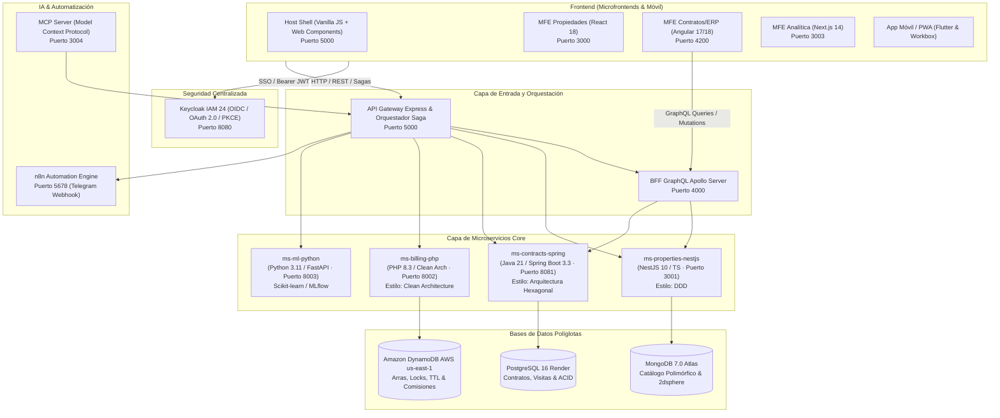
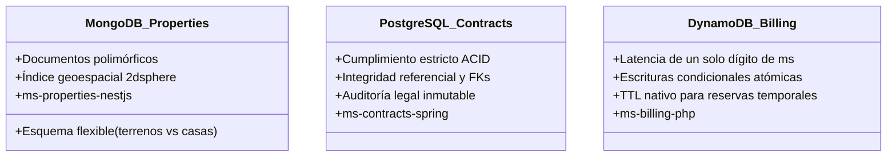
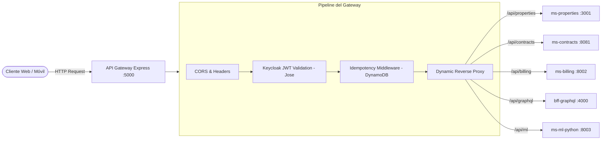
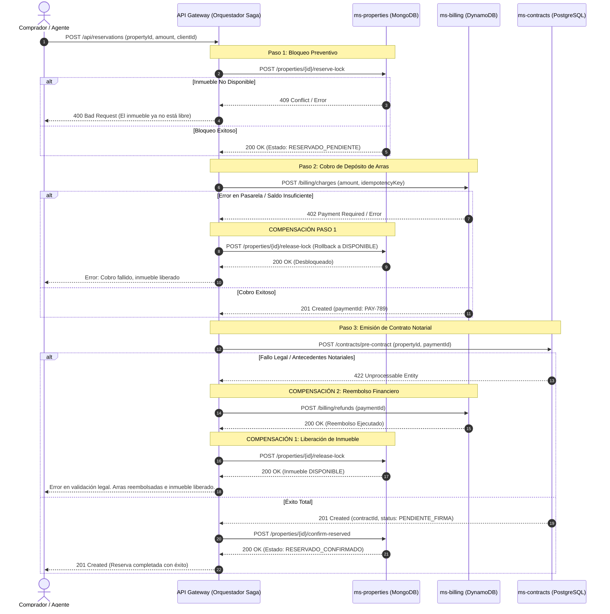

# Documentación Integral del Sistema Habitat Pro
## Arquitectura, Tecnologías por Microservicio, Microfrontends, GraphQL, Bases de Datos, Gateway y Orquestador Saga

> **Propósito del Documento:** Guía técnica completa y estructurada para explicar, exponer y defender la arquitectura del software **Habitat Pro (PropTech)** ante docentes, evaluadores o equipos de desarrollo.

---

## 1. Visión General del Sistema

**Habitat Pro** es una plataforma inmobiliaria integral (PropTech) de misión crítica orientada a la gestión de todo el ciclo de vida inmobiliario: captación, catalogación de inmuebles con georreferenciación e inteligencia artificial, agenda de visitas, reservas de compra/alquiler con depósito de arras mediante transacciones distribuidas, generación y firma de contratos legales, liquidación de comisiones a corredores y análisis de inteligencia de negocios (BI).

El sistema implementa una **Arquitectura Políglota de Microservicios Desacoplados**, **Microfrontends independientes**, una capa unificada de **API Gateway con CQRS e Idempotencia**, un **BFF con GraphQL para el ERP**, un **Orquestador del Patrón Saga**, y un **Identity and Access Management (IAM) con Keycloak**.



---

## 2. Matriz Global de Tecnologías por Componente

| Componente | Tipo | Lenguaje / Runtime | Framework / Core Libs | Base de Datos / Storage | Estilo de Arquitectura Interna | Puerto Local |
|---|---|---|---|---|---|---|
| **`ms-properties-nestjs`** | Microservicio Backend | TypeScript (Node.js 20+) | NestJS 10, Mongoose, Class-Validator | **MongoDB 7.0** (Atlas en la nube) | **DDD (Domain-Driven Design)** | `:3001` |
| **`ms-contracts-spring`** | Microservicio Backend | Java 21 LTS | Spring Boot 3.3.4, Spring Data JPA, OAuth2 Resource Server | **PostgreSQL 16** (Render en la nube) | **Arquitectura Hexagonal (Ports & Adapters)** | `:8081` |
| **`ms-billing-php`** | Microservicio Backend | PHP 8.3 | Microframework PHP / AWS SDK for PHP | **Amazon DynamoDB** (AWS us-east-1 / Local `:8005`) | **Clean Architecture** (Robert C. Martin) | `:8002` |
| **`ms-ml-python`** | Microservicio Backend / ML | Python 3.11 | FastAPI, Uvicorn, Scikit-learn, Pandas, NumPy | Modelos serializados (`.joblib`, `.json`) | Pipeline de Inferencia & Entrenamiento | `:8003` |
| **`api-gateway` (`server.js`)** | API Gateway & Orquestador | JavaScript (Node.js) | Express, Jose (JWT), AWS SDK, WebPush VAPID | In-Memory (CQRS Cache) + DynamoDB (Idempotencia) | Gateway Proxy + Orquestador Saga + CQRS Read Model | `:5000` |
| **`bff-graphql-gateway`** | BFF Gateway | JavaScript (Node.js) | Apollo Server 4, GraphQL 16 | N/A (Consume `ms-properties` y `ms-contracts`) | Backend-For-Frontend (Federación de datos) | `:4000` |
| **`mfe-shell`** | Microfrontend Host | Vanilla JS / ES Modules | Web Components, Lucide Icons, Keycloak JS, Workbox | IndexedDB (`habitat-offline-db`), LocalStorage | Microfrontend Host Container (Orquestador UI) | `:5000` (raíz) |
| **`mfe-properties-react`** | Microfrontend Remoto | JavaScript / JSX | React 18, Webpack 5 Module Federation, TensorFlow.js | Memoria de cliente / Canvas API | Component-Driven UI | `:3000` / `/mfe/properties` |
| **`mfe-contracts-angular`** | Microfrontend Remoto | TypeScript | Angular 17/18, RxJS, Reactive Forms, Webpack MF | Memoria de cliente | Enterprise ERP Layer | `:4200` / `/mfe/contracts` |
| **`mfe-bi-next`** | Microfrontend Remoto | JavaScript / React | Next.js 14, Recharts, Lucide React, Web Components | Consumo de `/api/bi/overview` | SSR / Dashboard Analytics | `:3003` / `/mfe/bi` |
| **`mobile_habitat_flutter`** | App Móvil / Híbrida | Dart | Flutter 3.x, Geolocator, Speech_to_Text, Local Notifications | SharedPreferences / SQLite / Cache | Clean Mobile Architecture (Offline-First) | N/A (APK / Emulador) |
| **`mcp-habitat-server`** | Servidor de IA (MCP) | JavaScript (Node.js) | Model Context Protocol SDK, Zod | N/A (Llama al Gateway con token de usuario) | Tool-Provider para LLMs (Claude) | `:3004` |
| **`keycloak-sso`** | Infraestructura IAM | Java | Keycloak 24.0.2 en Docker | PostgreSQL interno de Keycloak | OAuth2, OIDC, PKCE, RBAC | `:8080` |
| **`n8n-automation`** | Orquestador de Flujos | TypeScript / Node.js | n8n Workflow Engine en Docker | SQLite / Postgres interno | Event-Driven Webhooks & Telegram Bot | `:5678` |

---

## 3. Microservicios Backend en Detalle

### 3.1. `ms-properties-nestjs` (Catálogo de Inmuebles y Multimedia)
- **Tecnología:** NestJS 10 sobre Node.js con TypeScript.
- **Base de Datos:** **MongoDB 7.0** (MongoDB Atlas en producción).
- **Estilo de Arquitectura Interna:** **Domain-Driven Design (DDD)**.
  - **Agregado Raíz (`Property`):** Concentra invariantes del negocio en `src/properties/domain/`. Ejemplo: *únicamente un inmueble en estado `DISPONIBLE` puede ser bloqueado o reservado*.
  - **Value Objects:** `Money` (precio + moneda USD/BOB) y `GeoLocation` (latitud, longitud, radio).
  - **Eventos de Dominio:** Publicación de eventos como `PropertyReservedDomainEvent` o `PropertySoldDomainEvent`.
  - **Inversión de Dependencias:** El repositorio `PropertyRepository` es una interfaz del dominio puro; su implementación (`MongoPropertyRepository`) reside en la capa de `infrastructure/` usando Mongoose.
- **Funcionalidades Clave:**
  - Búsqueda geoespacial mediante operador MongoDB `$nearSphere` e índice `2dsphere` ("inmuebles a menos de 5 km").
  - Gestión polimórfica de propiedades (departamentos con dormitorios y expensas vs. terrenos con topografía y zonificación vs. oficinas).
  - Bloqueo preventivo de inmuebles (`/reserve-lock`) y confirmación para el patrón Saga.

### 3.2. `ms-contracts-spring` (Contratos, Asuntos Legales, Visitas y Usuarios)
- **Tecnología:** Java 21 LTS con Spring Boot 3.3.4.
- **Base de Datos:** **PostgreSQL 16** (Render en producción).
- **Estilo de Arquitectura Interna:** **Arquitectura Hexagonal (Ports & Adapters)**.
  - **Dominio Puro (`com.proptech.contracts.domain`):** Clases como `ContractRules`, `Contract`, `Signature` sin dependencias de frameworks ni anotaciones de JPA o Spring.
  - **Puertos de Entrada (`Port.In`):** Interfaces para casos de uso (`CreateContractUseCase`, `SignContractUseCase`, `CancelContractUseCase`, `ScheduleAppointmentUseCase`).
  - **Puertos de Salida (`Port.Out`):** Interfaces como `ContractRepositoryPort`.
  - **Adaptadores:** 
    - *Driving (Entrada):* Controladores REST en `adapter/in/web/` securizados con Spring Security OAuth2 Resource Server.
    - *Driven (Salida):* Adaptadores JPA en `adapter/out/persistence/` con Spring Data JPA y drivers de PostgreSQL.
- **Funcionalidades Clave:**
  - Garantía de transacciones **ACID** para contratos legales notariales.
  - Emisión de pre-contrato notarial con referencia a pago de arras (`/pre-contract`).
  - Trazabilidad y validación de firma electrónica de dos partes (cliente y oficial legal).
  - Gestión de empleados y sectores organizacionales (`LEGAL`, `AGENTE`, `FINANZAS`, `ATENCION`).

### 3.3. `ms-billing-php` (Facturación, Cobros, Arras y Comisiones)
- **Tecnología:** PHP 8.3 con microframework de alto rendimiento y AWS SDK for PHP.
- **Base de Datos:** **Amazon DynamoDB** (AWS us-east-1 / DynamoDB Local en desarrollo).
- **Estilo de Arquitectura Interna:** **Clean Architecture (Onion Architecture)**.
  - **Capa Entidades (`src/Domain`):** `BillingRules`, `Charge`, `Commission`.
  - **Capa Casos de Uso (`src/Application`):** Casos de uso atómicos como `ChargeArrasUseCase`, `RefundChargeUseCase`, `CalculateAgentCommissionUseCase`, `RegisterPaymentInstallmentUseCase`.
  - **Capa Interfaces/Controladores (`src/Controllers`):** Adaptadores HTTP que reciben DTOs y validan cabeceras como `Idempotency-Key`.
  - **Capa Infraestructura (`src/Infrastructure`):** Repositorio `DynamoBillingRepository` que interactúa con las tablas de DynamoDB (`habitat_charges`, `habitat_commissions`, `habitat_reservations`).
- **Funcionalidades Clave:**
  - Cobro atómico de arras y emisión de recibo digital (`/charges`).
  - Reembolso inmediato programático (`/refunds`) ante fallos en la Saga.
  - TTL (Time to Live) automático de reservas que vencen en 48 horas sin requerir workers externos de limpieza.
  - Cálculo escalonado de comisiones porcentuales para brokers inmobiliarios.

### 3.4. `ms-ml-python` (Microservicio de Inteligencia Artificial & Modelos Predictivos)
- **Tecnología:** Python 3.11, FastAPI, Uvicorn, Scikit-learn, Pandas, NumPy.
- **Funcionalidades Clave:**
  - **CU03 — Estimación de Precio de Mercado (Regresión):** Algoritmo **Random Forest Regressor** ($R^2 \approx 0.89$) entrenado con características físicas (superficie, dormitorios, baños) y zonificación socioeconómica para sugerir precios razonables al publicar.
  - **CU13 — Segmentación de Clientes e Inversionistas (Clustering):** Algoritmo **K-Means** no supervisado para agrupar clientes según presupuesto, nivel de actividad y perfil de compra.
  - Exposición de endpoints REST rápidos (`/predict/price`, `/cluster/client`) y gráficos de entrenamiento para visualización académica.

---

## 4. Estrategia Políglota de Bases de Datos: ¿Qué BD está en qué Microservicio y Por Qué?

Una de las decisiones arquitectónicas más importantes del sistema es la **Persistencia Políglota (Polyglot Persistence)**: cada microservicio utiliza el motor de base de datos que mejor resuelve sus características intrínsecas de consistencia, volumen y modelo de acceso.



### 4.1. MongoDB 7.0 en `ms-properties`
- **¿Por qué NO una base de datos relacional tradicional?**
  Las propiedades inmobiliarias tienen una **alta heterogeneidad de atributos (polimorfismo)**:
  - Un *departamento* contiene: piso, expensas mensuales, ascensor, balcón, área común.
  - Un *terreno* contiene: topografía, frente, fondo, tipo de suelo, coeficientes de edificación.
  - Una *oficina comercial* contiene: capacidad eléctrica (KVA), cajones de estacionamiento, salas de juntas.
  En una base relacional, esto provocaría decenas de tablas con uniones complejas (*JOINs*) o tablas con cientos de columnas nulas (*Sparse Tables*).
- **Ventaja decisiva:** MongoDB maneja documentos JSON nativos con validación de esquemas y posee soporte nativo para **índices geoespaciales `2dsphere`**, permitiendo calcular distancias euclidianas/geodésicas en milisegundos (`$nearSphere`).

### 4.2. PostgreSQL 16 en `ms-contracts`
- **¿Por qué NO una base de datos documental?**
  Los contratos legales, promesas de compraventa y actas de visita exigen cumplimiento irrestricto de las propiedades **ACID** (Atomicidad, Consistencia, Aislamiento, Durabilidad):
  - Integridad referencial estricta: un contrato no puede existir sin un cliente válido, un agente asignado y una propiedad verificada.
  - El proceso de firmas concurrentes requiere aislamiento de transacciones (Serializable / Read Committed) para evitar que dos partes alteren cláusulas en disputa.
- **Ventaja decisiva:** Garantía notarial y forense de integridad, tablas históricas y confiabilidad probada para transacciones comerciales reguladas.

### 4.3. Amazon DynamoDB en `ms-billing-php`
- **¿Por qué DynamoDB para pagos y arras?**
  1. **Bloqueos Rápidos y Escrituras Condicionales:** Cuando un proyecto inmobiliario abre preventa, decenas de agentes compiten por bloquear una unidad al mismo tiempo. DynamoDB permite escrituras atómicas con `ConditionExpression` (`attribute_not_exists(propertyId)`), previniendo ventas dobles (*double-booking*) sin sobrecargar bloqueos de tabla.
  2. **TTL (Time To Live) Nativo:** Las reservas inmobiliarias con arras tienen un tiempo de validez de 48 a 72 horas. DynamoDB elimina automáticamente los registros expirados o activa eventos de DynamoDB Streams sin necesidad de ejecutar tareas cron en el servidor.
  3. **Escalabilidad Horizontal y Baja Latencia:** Tiempos de respuesta de menos de 10 ms para transacciones financieras y liquidación de comisiones.

---

## 5. Microfrontends (Frontend): Tecnologías, Estrategia y Comunicación

En el frontend se adoptó una arquitectura de **Microfrontends (MFE)** para permitir que equipos independientes trabajen con los frameworks donde son más productivos, evitando monolitos de interfaz.

```text
┌────────────────────────────────────────────────────────────────────────┐
│                   MFE SHELL (Host - Vanilla JS / Web Components)        │
│          Barra de Navegación · Sesión Keycloak (SSO) · Event Bus Global│
├──────────────────┬───────────────────────┬─────────────────────────────┤
│  MFE PROPERTIES  │     MFE CONTRACTS     │          MFE BI             │
│    (React 18)    │     (Angular 17)      │        (Next.js 14)         │
│                  │                       │                             │
│ Catálogo, Filtros│ ERP Legal Corporativo │ Dashboards Analíticos       │
│ Mapa y Visitas   │ Formularios Dinámicos │ Métricas y Gráficos         │
│ TensorFlow.js IA │ Consultas GraphQL     │ Exportación e Indicadores   │
└──────────────────┴───────────────────────┴─────────────────────────────┘
```

### 5.1. `mfe-shell` (El Host / Contenedor Orquestador)
- **Tecnología:** Vanilla JavaScript, Web Components estándar, HTML5, CSS moderno con variables compartidas de diseño.
- **Responsabilidades:**
  - **Single Sign-On (SSO):** Inicializa `keycloak-js`, gestiona la renovación silenciosa del token JWT y suministra la identidad del usuario a los microfrontends hijos.
  - **Enrutamiento y Carga Perezosa (*Lazy Loading*):** Carga los microfrontends remotos según la ruta solicitada (`/`, `/contracts`, `/bi`).
  - **Event Bus Desacoplado:** Sistema de mensajería basado en `CustomEvent` (`window.dispatchEvent` / `window.addEventListener`) bajo el espacio de nombres `habitat:*` (ej. `habitat:property-selected`, `habitat:reservation-completed`).
  - **Sistema de Íconos Unificado:** Expone `window.HabitatIcons` (Lucide Icons estándar) para evitar que cada framework cargue librerías de íconos pesadas distintas.
  - **Soporte PWA Offline:** Registra el `sw.js` (Service Worker) y gestiona la cola de sincronización en `IndexedDB`.

### 5.2. `mfe-properties-react` (Catálogo y Ficha de Inmuebles)
- **Tecnología:** React 18, JSX, Webpack 5 Module Federation.
- **Por qué React:** Excelente ecosistema para interfaces dinámicas con renderizado reactivo de mapas, filtros instantáneos y procesamiento en cliente.
- **Inteligencia Artificial en el Navegador (Edge AI):** Incorpora **TensorFlow.js con el modelo cuantizado COCO-SSD** (~4.8 MB). Permite que el agente suba fotos de una casa y el navegador detecte automáticamente camas, refrigeradores, hornos o inodoros para autocompletar dormitorios y baños sin gastar créditos en servidores de visión por computadora.

### 5.3. `mfe-contracts-angular` (ERP de Contratos y Gestión Notarial)
- **Tecnología:** Angular 17/18, TypeScript, RxJS, Angular Reactive Forms.
- **Por qué Angular:** Su sistema de tipado estricto, Inyección de Dependencias (DI) y formularios reactivos complejos (`FormGroup`, `FormArray`) resultan ideales para construir software empresarial corporativo (ERP legal), donde la validación de cláusulas y validación de poderes legales no admite ambigüedad.
- **Consumo:** Es el principal cliente del **BFF GraphQL Gateway**.

### 5.4. `mfe-bi-next` (Dashboards e Inteligencia de Negocios)
- **Tecnología:** Next.js 14, React, Recharts.
- **Por qué Next.js:** Especializado en analítica y renderizado eficiente. Se compila tanto como aplicación independiente como exportable en formato Web Component (`<mfe-bi>`) para montarse dentro del contenedor del Shell.
- **Consumo:** Se nutre directamente del endpoint consolidado de CQRS (`/api/bi/overview`).

### 5.5. `mobile_habitat_flutter` (App Móvil para Clientes y Agentes en Campo)
- **Tecnología:** Flutter 3.x / Dart.
- **Capacidades Nativas:**
  - Geolocalización satelital (GPS) para check-in de visitas.
  - Reconocimiento de voz a texto (`speech_to_text`) para dictar consultas.
  - Cámara con compresión para carga de fotos a S3.
  - Notificaciones push locales y remotas.

---

## 6. Dónde y Cómo se Usa GraphQL

### 6.1. ¿Dónde se usa?
GraphQL se utiliza en el **BFF (Backend-For-Frontend)** ubicado en el directorio `bff-graphql-gateway/` (puerto `4000`), expuesto también a través del API Gateway en la ruta `/api/graphql`.

### 6.2. ¿Por qué GraphQL frente a REST en el Sistema de Gestión Empresarial (ERP)?
En la gestión corporativa de contratos inmobiliarios, una API REST convencional presenta dos graves problemas de rendimiento y diseño:

1. **Problema del Over-fetching (Sobredatos):**
   Un inmueble tiene más de 60 atributos registrados en MongoDB (descripción, fotos en CDN, amenidades, coordenadas, historial, comisiones, expedientes). Si la tabla de revisión legal del ERP solo necesita mostrar:
   - `código del contrato`, `nombre del cliente`, `dirección del inmueble` y `precio total`.
   Una llamada REST a `/properties/:id` devolvería cientos de kilobytes innecesarios. En GraphQL, el cliente pide **únicamente los campos que su interfaz va a pintar**, reduciendo el ancho de banda drásticamente.

2. **Problema del Under-fetching y N+1 Roundtrips (Múltiples peticiones HTTP en cascada):**
   Para mostrar la ficha completa de un contrato legal, un cliente REST tendría que hacer múltiples llamadas secuenciales:
   ```text
   GET /contracts/501              --> Devuelve contract.propertyId, contract.clientId, contract.agentId
   GET /properties/PROP-99         --> Devuelve ficha de propiedad
   GET /clients/CLI-12             --> Devuelve datos del comprador
   GET /employees/AGT-04           --> Devuelve datos del broker
   ```
   Con GraphQL, el frontend del ERP ejecuta **una única llamada POST** con una consulta anidada:

```graphql
query ObtenerRevisionLegal($id: ID!) {
  contract(id: $id) {
    id
    contractNumber
    status
    totalAmount
    downPayment
    property {
      code
      title
      address
      price
    }
    client {
      fullName
      identificationNumber
      email
    }
    agent {
      fullName
      phone
    }
  }
}
```

### 6.3. ¿Cómo funciona internamente el BFF GraphQL Gateway?
- Está construido con **Apollo Server 4**.
- Lee el archivo `schema.graphql` como contrato tipado estricto (*Schema-First*).
- **Resolvers Inteligentes y Desacoplados:**
  - `Query.contracts` llama internamente vía REST a `ms-contracts-spring` (`:8081/api/v1/contracts`).
  - Al resolver el campo anidado `Contract.property`, el resolver consulta a `ms-properties-nestjs` (`:3001/api/v1/properties`).
  - **Optimización anti-N+1:** Cuenta con la función `propertyIndex(ctx)` que indexa las propiedades en una sola promesa por petición, evitando consultar repetidamente la misma propiedad si varios contratos corresponden al mismo inmueble.
  - **Propagación del Token:** Extrae la cabecera `Authorization: Bearer <JWT>` enviada por el frontend y la reenvía en cada llamada a los microservicios backend, manteniendo los privilegios del usuario intactos.

---

## 7. Cómo Funciona el API Gateway (`server.js`)

El archivo `server.js` (puerto `5000`) es el **punto de entrada unificado** a toda la plataforma. Actúa como Gateway de API, servidor de aplicaciones de los Microfrontends y orquestador central de operaciones compuestas.



### 7.1. Funciones Principales del Gateway:
1. **Validación Centralizada de Seguridad (Keycloak OIDC):**
   - Utiliza `jose` y `createRemoteJWKSet` contra el endpoint de Keycloak (`/protocol/openid-connect/certs`).
   - Valida la firma del token criptográfico, el emisor (`issuer`) y su fecha de expiración en cada petición a rutas privadas.
   - Enruta el contexto del usuario (`req.user`) mediante `AsyncLocalStorage` para que viaje en los llamados internos.
   - Cuenta con una lista de rutas públicas excluidas (catálogo de consulta, geobúsqueda, endpoints de salud).

2. **Middleware de Idempotencia para Operaciones Críticas:**
   - Ubicado en `idempotency/middleware.js`.
   - Aplica a rutas sensibles a duplicaciones (`/api/reservations`, `/api/payments`, `/api/appointments`).
   - Lee el encabezado `Idempotency-Key` enviado por el cliente. Si un cliente móvil con mala señal envía la misma petición 2 veces:
     - La primera petición se procesa y guarda la respuesta en DynamoDB con un TTL de 24 horas.
     - La segunda petición es interceptada y responde con el resultado previo idéntico, evitando cobrar dos veces o crear dos contratos.

3. **Modelo de Lectura Consolidado (CQRS Read Model):**
   - Implementado en `bi/read-model.js` (`GET /api/bi/overview`).
   - Resuelve el reto de leer datos consolidados de negocio en una arquitectura de microservicios con bases de datos separadas.
   - Consulta **en paralelo** a `ms-properties` (MongoDB), `ms-contracts` (PostgreSQL) y `ms-billing` (DynamoDB).
   - Cruza la información en memoria: calcula el embudo comercial, ingresos por mes y cartera sin requerir costosos procesos de replicación síncrona.
   - **Caché con Invalidation Automática:** Guarda el resultado en memoria durante 60 segundos; cualquier mutación o escritura exitosa (POST/PUT/PATCH/DELETE) limpia la caché al instante.

4. **Web Push y Notificaciones VAPID:**
   - Gestiona las suscripciones del navegador y envía notificaciones automáticas cuando una reserva es confirmada o reembolsada.

---

## 8. Cómo Funciona el Orquestador y el Patrón Saga (Transacciones Distribuidas)

### 8.1. El Problema que Resuelve
En una arquitectura de microservicios con **bases de datos independientes (Database-per-Service)**, no es posible utilizar una transacción SQL tradicional (`BEGIN TRANSACTION ... COMMIT`) que abarque MongoDB, PostgreSQL y DynamoDB simultáneamente. 

El protocolo de compromiso en dos fases (2PC - Two-Phase Commit) genera cuellos de botella severos, bloqueos prolongados y no es compatible con motores NoSQL en la nube. Por ello, se implementa el **Patrón Saga Orquestado con Acciones Compensatorias**.

### 8.2. Escenario de Negocio: "Reserva Formal de Inmueble con Depósito de Arras"
Para concretar la reserva de un departamento:
1. Se debe bloquear el inmueble en `ms-properties` (**MongoDB**).
2. Se debe cobrar la seña o arras bancarias ($5,000 USD) en `ms-billing` (**DynamoDB**).
3. Se debe generar el pre-contrato legal de reserva en `ms-contracts` (**PostgreSQL**).

Si el cobro falla, o si el comprador no supera la validación legal en notarías, **el sistema no puede quedar en estado inconsistente** (el inmueble no puede quedar bloqueado eternamente ni el dinero cobrado sin contrato). El orquestador ejecuta **transacciones compensatorias (Rollbacks semánticos)** en orden inverso.

### 8.3. Diagrama de Secuencia del Patrón Saga



### 8.4. Dónde vive el Orquestador
1. **En Producción / Gateway Principal:** Se encuentra integrado en `server.js` dentro del handler `app.post('/api/reservations')`. Registra un objeto de rastreo (`sagaTrace`) con marcas booleanas (`step1_locked`, `step2_charged`, `step3_contract_created`), capturando cualquier excepción para ejecutar las llamadas de compensación inmediatamente.
2. **En Módulo Aislado / Script CLI:** En el archivo `saga-orchestrator/orchestrator.js` existe la implementación pura desacoplada con la función `executeSagaReservation()`, útil para pruebas automatizadas o ejecución como worker independiente.

---

## 9. Componentes de Inteligencia Artificial y Automatización

### 9.1. Servidor MCP (`mcp-habitat-server`)
- Implementa el estándar abierto **Model Context Protocol (MCP)** impulsado por Anthropic.
- Permite que modelos avanzados de lenguaje (como **Claude**) ejecuten herramientas operativas sobre el negocio inmobiliario de forma segura.
- **Seguridad Garantizada:** Todas las herramientas son de **estricta solo lectura** con esquemas validados con Zod (`consultar_inmuebles`, `resumen_negocio`, `consultar_visitas`). No se permite la generación libre de sentencias SQL ni accesos directos a las bases de datos.
- Utiliza la identidad y permisos del usuario conectado para respetar las políticas de acceso por rol (RBAC).

### 9.2. Flujo de Automatización con `n8n`
- Corre en Docker en el puerto `5678`.
- Escucha eventos provenientes del Gateway a través de webhooks.
- **Caso de Uso 14 (Telegram):** Cuando el Gateway culmina satisfactoriamente la Saga de reserva, dispara un webhook a n8n, el cual formatea un mensaje detallado con los datos de la reserva y notifica al canal oficial de Telegram de la inmobiliaria en tiempo real.
- **Caso de Uso 21 (Agente Monitor Programado):** Tareas programadas (*cron jobs*) en n8n despiertan al agente monitor del Gateway para verificar contratos a punto de vencer o visitas desatendidas.

---

## 10. Guía Rápida para Defender / Explicar el Software en una Evaluación

Si te preguntan durante la defensa del proyecto:

1. **"¿Por qué tienen tres microservicios en tres lenguajes distintos?"**
   > *"Demuestra una arquitectura políglota real. Cada microservicio fue desarrollado según sus fortalezas: NestJS (TypeScript) por su velocidad y soporte nativo con MongoDB y GeoJSON; Spring Boot (Java) por su robustez transaccional y cumplimiento estricto de reglas de negocio en contratos; y PHP por su alta velocidad para transacciones ligeras y casos de uso de facturación interactuando con DynamoDB."*

2. **"¿Cómo garantizan consistencia si no tienen una sola base de datos?"**
   > *"A través de Consistencia Eventual y el Patrón Saga Orquestado en el Gateway. No usamos transacciones distribuidas 2PC porque bloquean los recursos; en su lugar, implementamos transacciones de avance y transacciones compensatorias que hacen rollback semántico (liberar la propiedad y reembolsar el cobro) si algún paso falla."*

3. **"¿Dónde está GraphQL y por qué no usarlo en todo el sistema?"**
   > *"GraphQL está en el BFF del ERP corporativo (`bff-graphql-gateway`). No lo usamos en todo porque no todos los clientes lo necesitan: la app móvil y las APIs públicas usan REST por simplicidad de caché HTTP; pero el ERP legal lo requiere obligatoriamente para resolver el problema de over-fetching y bajo rendimiento (N+1 queries) al unir datos de propiedades y contratos en un solo viaje de red."*

4. **"¿Qué pasa si un usuario presiona dos veces el botón de reservar por una conexión lenta?"**
   > *"El sistema implementa el estándar de Idempotency-Key. El cliente genera un UUID único para la transacción; el Gateway lo intercepta en DynamoDB. Si la petición ya fue procesada, responde con el resultado existente sin reejecutar la Saga, evitando duplicaciones de cobros o contratos."*

5. **"¿Cómo se autentican los microservicios?"**
   > *"Usamos Keycloak como servidor central de identidad bajo OAuth2 y OpenID Connect con flujo PKCE. El frontend obtiene un token JWT firmado que el Gateway y los microservicios validan criptográficamente con el conjunto de claves públicas JWKS de Keycloak sin consultar a la base de usuarios en cada llamada."*
